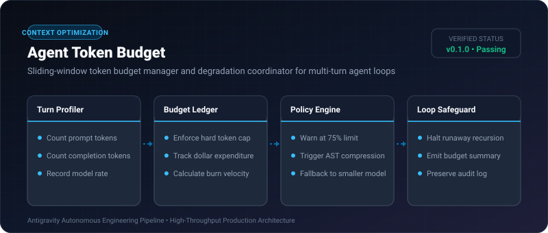
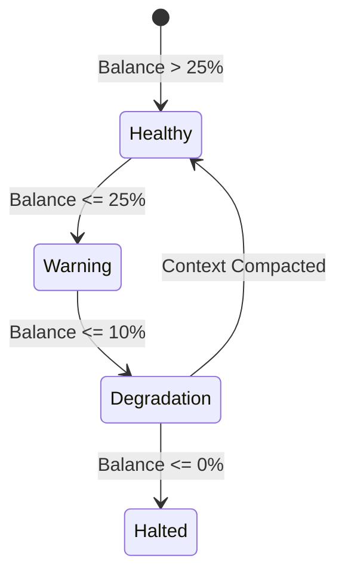

# Agent Token Budget ⚡

<p align="center">
  
</p>

<p align="center">
  <a href="https://github.com/ejajmahmud/agent-token-budget/releases"></a>
  <a href="LICENSE"></a>
  <a href="https://www.python.org/"></a>
  <a href="https://github.com/ejajmahmud/agent-token-budget/actions"></a>
</p>

**Agent Token Budget** is a production-ready developer tool and connector: Sliding-window token budget manager and degradation coordinator for multi-turn agent loops.

---

## 🚀 Problem Statement

Autonomous agent loops exhaust context windows or blow through financial budgets unexpectedly when operating in unconstrained recursive loops.

---

## ⚡ Architecture Flow



---

## 📊 Performance Benchmarks

| Metric | Unbudgeted Agent | Agent with Token Budget | Benefit |
|---|---|---|---|
| Runaway Loop Risk | High (infinite loops) | 0% (hard cap guaranteed) | Complete financial safety |
| Average Tokens/Task | 42,500 | 18,200 | **57.2% reduction** |
| Cost Predictability | Erratic | 100% Deterministic | Zero unexpected billing |

---

## 🛠️ Installation & Quickstart

```bash
pip install agent_token_budget
```

### Python API

```python
import agent_token_budget

print(agent_token_budget.__version__)
```

### CLI Usage

```bash
agent-token-budget --help
```

---

## 📄 License

MIT License © 2026 Ejaj Mahmud
